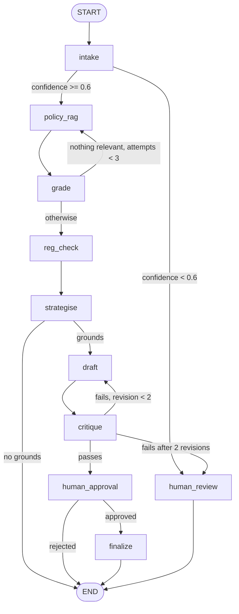

# Architecture

## Graph

`human_approval` calls LangGraph's `interrupt()`. The graph is defined in `lib/agents/graph.js`; the shared state is in `lib/agents/state.js`.

## Request flow

1. `POST /api/analyze` runs the graph from the documents to the interrupt and streams one line per finished agent (NDJSON). The last line carries the result and a **signed case token**.
2. `POST /api/resume` verifies the token, reloads the state into a fresh checkpointer as if `critique` had just finished, lets the graph reach `interrupt()` again, and resumes it with `Command({ resume })`.
3. `POST /api/escalate` checks Ombudsman eligibility, then re-enters the graph at `draft` with `stage = "ombudsman"`.

## Why a signed token instead of a database

Serverless functions do not share memory, so an in-memory checkpoint would be lost between the analysis and the approval. A production build would use LangGraph's `PostgresSaver`. For a course demo that must deploy with zero setup, the checkpoint travels with the browser and is protected by an HMAC signature (`lib/state-token.js`): the server only accepts a state it produced, so a client cannot forge an approval or swap the grounds. The uploaded documents are not kept in the token.

## Model routing

`lib/llm/router.js` picks the provider from environment variables (Groq, then Gemini, then Anthropic), sends extraction, grading and planning to the cheap model and strategy, drafting and critique to the strong one, retries on 429/503, retries once without optional parameters on 400, and reports tokens and estimated cost per call. Every agent catches a failed call and falls back to the offline engine for that step.

## What is deterministic in both modes

- All rule checks (`lib/rules/tools.js`) and their arguments.
- The citation allow-list: only ids in `lib/rules/rules.js` and clauses actually retrieved from the user's policy.
- The Critic's hard checks (citations resolve, amounts match the facts, mandatory elements, tone).
- The approval gate and the absence of any send capability.

## Scaling path (not built)

Supabase Postgres with row-level security and pgvector for hybrid search, `PostgresSaver` checkpoints, a queue for long analyses, object storage for uploads, OTP sign-in, scheduled reminder emails, LangSmith online evaluators.
